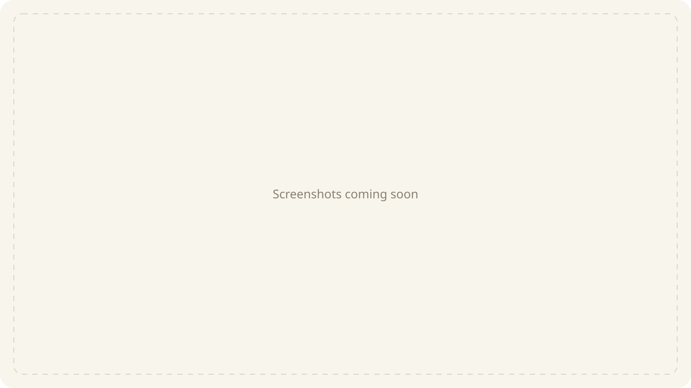

<p align="center">
  
</p>

<h1 align="center">Ress</h1>

<p align="center">A personal RSS reader for Android, with a little yellow paper feel.</p>

<!-- Replace this image with one thumbnail containing 3–4 phone screenshots.
     Suggested screens: feed, reader, sources, and Android home widget. -->


Ress keeps the sites you follow in one place. Add your feeds, read the latest posts, and save the ones you want to come back to. It starts empty, so every source is yours to choose.

No account, backend, or API key required. Built with Expo, React Native, and TypeScript.

## Reading

- Follow RSS and Atom feeds in a newest-first timeline.
- Open the original web page inside Ress, or toggle reading mode from the header.
- Keep bookmarks in a searchable saved list and read cached feed text offline.
- Choose Web page or Reading mode as the default in **Settings → Reading**.
- Pick a reading text size and use a light, dark, or device theme.
- Share an article or open it in your device's browser.

Reading mode extracts text from the loaded web page using Mozilla Readability and displays it with Ress's theme and text size. Switching back keeps the web page open in place. Some pages, including player pages and sites that restrict access, may not provide readable article text. If extraction fails, Ress labels and shows the cached RSS text as a fallback. Recently extracted pages are also cached locally; this cache is limited and older reading copies may be removed.

## Your sources

Add feed URLs individually or import an OPML file from another reader. You can edit source names and icons, drag sources into your preferred order, and swipe to remove them.

OPML export includes feed titles and categories, so you can take your subscriptions elsewhere. It doesn't include bookmarks or reading history. On Android, exports are saved to the Download folder.

## Android widget

Put the latest 10 posts on your home screen with a resizable widget. Each widget has its own source and unread filters. Tap a headline to read it in Ress, or refresh directly from the widget.

Add it through **Settings → Widget → Add widget to home screen**, or your launcher's widget picker. Refreshes are scheduled every 30 minutes, though Android's battery restrictions can delay them.

## Storage and privacy

Subscriptions, bookmarks, reading history, and cached articles stay on your device. Feed requests and article page loads go directly to publishers. Embedded websites can load their own cookies, scripts, and third-party resources, just as they do in a browser. Ress has no tracking or sync service.

Website icon previews use Google's favicon service. Icons you upload stay on your device.

The cache keeps the 600 most recent articles plus saved articles. If some feeds fail to refresh, their cached articles remain available.

## Local development

Install [Bun](https://bun.sh), then run:

```sh
bun install
bun start
```

Expo Go can run the reader. The Android widget, saving OPML exports to Download, and explicitly targeting the device's browser require a native build with the project's native modules included. Expo Go falls back to the system URL handler for external links.

After changing the page extraction script or updating Mozilla Readability, regenerate its bundled script with `bun scripts/build-reader.ts`.

Ress is a mobile app for Android.

## Checks

```sh
bun run typecheck
bun test
```
